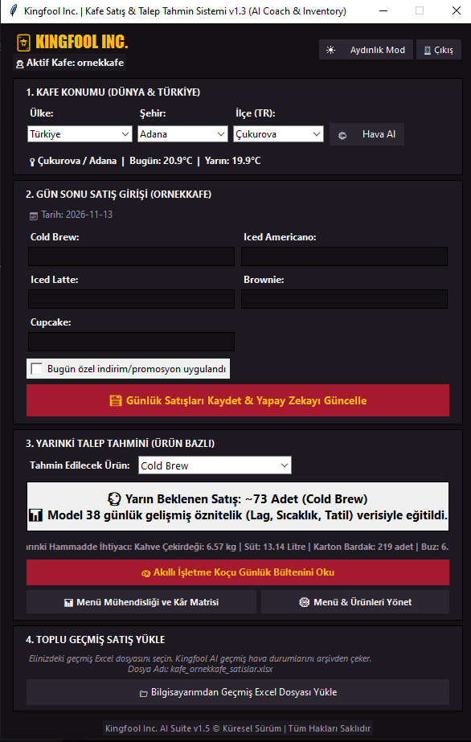
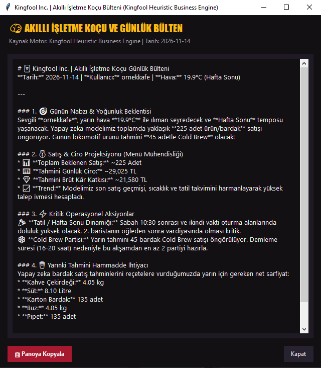
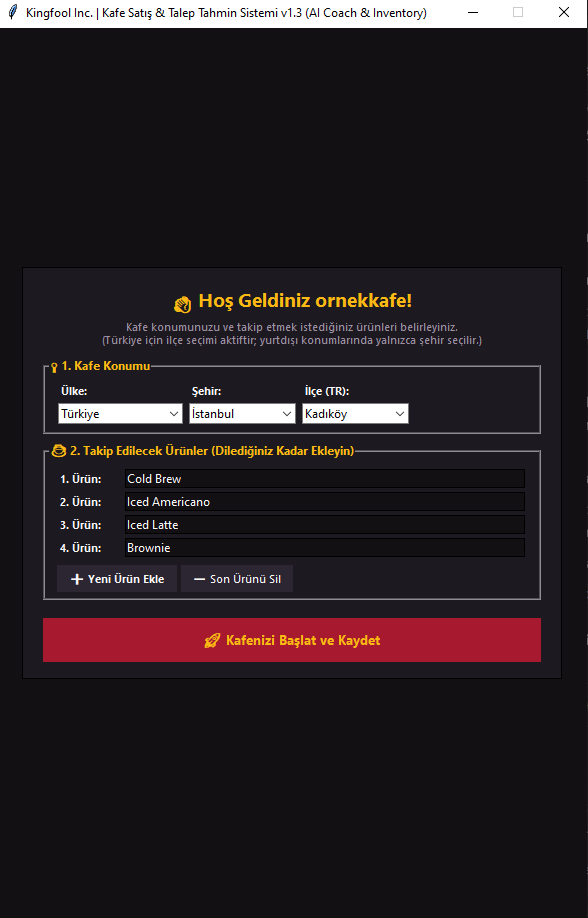

# 🃏 Kingfool Inc. — Kafe Satış Tahmini ve İşletme Asistanı

Kafelerin günlük ürün satışlarını makine öğrenmesiyle tahmin eden; bu tahminden hammadde ihtiyacını, menü kârlılığını ve günlük işletme önerilerini çıkaran bir uygulama. Masaüstü programı, REST API ve Android uygulaması olarak üç parçadan oluşur.

**Sürüm:** v1.5 · **Durum:** çalışan prototip, geliştirme sürüyor

▶️ **[Tarayıcıda dene](https://bmihci.github.io/CafePredictionApp/demo/)**: tahmin motoru örnek veriyle tarayıcıda çalışır; hava, hafta sonu ve promosyonu değiştirip yarının satış tahminini ve gereken hammaddeyi gör. Kurulum gerekmez.

> Küçük bir kafe "yarın kaç Cold Brew satarım, ne kadar süt ve kahve hazırlamalıyım?" sorusuna sezgiyle yanıt verir. Bu proje aynı soruyu geçmiş satış, hava durumu, haftanın günü, promosyon ve tatil bilgisiyle yanıtlamayı dener.

<p align="center">
  
  
  
</p>
<p align="center"><sub>Ana ekran ve tahmin · Günlük işletme bülteni · İlk kurulum sihirbazı</sub></p>

---

## Neler yapar?

| Özellik | Açıklama | Dosya |
|---|---|---|
| **Satış tahmini** | Her ürün için ayrı bir Random Forest modeli eğitir ve yarının satış adedini tahmin eder. Yeni satış girildikçe model yeniden eğitilir. | `ml_ops.py` |
| **Canlı hava durumu** | Open-Meteo üzerinden kafenin konumuna göre sıcaklık çeker. Türkiye'nin 81 ili ve birkaç ülke tanımlıdır. | `locations.py` |
| **Tatil ve etkinlik takvimi** | Resmi tatilleri, dini bayramları ve elle eklenen yerel etkinlikleri (maç, konser) tahmine katar. | `calendar_events.py` |
| **Hammadde ihtiyacı** | Tahmin edilen adetleri reçetelerle çarpıp kg, litre ve adet olarak sarfiyat ve stok uyarısı üretir. | `inventory_manager.py` |
| **Menü mühendisliği** | Porsiyon maliyeti ve satış adedine göre ürünleri dört gruba ayırır: Yıldızlar, İş Atları, Bulmacalar, Köpekler. | `menu_engineering.py` |
| **Günlük işletme bülteni** | Tahminlerden kısa bir aksiyon listesi yazar. Gemini API anahtarı varsa onu, yoksa yerleşik kural tabanlı motoru kullanır. | `llm_coaching.py` |
| **Grafikler** | Satış trendi, sıcaklık ilişkisi, öznitelik önemleri ve menü matrisi. | `analytics_charts.py` |

### Tahmin modeli nasıl çalışır?

Model her ürün için şu dokuz özniteliği kullanır:

- **Günün koşulları:** sıcaklık, hafta sonu mu, promosyon var mı, tatil mi
- **Takvim:** ay, haftanın günü
- **Geçmiş satış:** bir önceki günün ve geçen haftanın aynı gününün satışı (`Satis_Lag1`, `Satis_Lag7`)
- **Etkileşim:** sıcaklık × promosyon

Ayrıntılı anlatım: [MLCC_ve_Feature_Engineering_Rehberi.md](MLCC_ve_Feature_Engineering_Rehberi.md)

---

## Hızlı deneme (2 dakika)

Arayüz, API ya da veritabanı kurmadan tahmin motorunu örnek veriyle çalıştırabilirsiniz:

```bash
git clone https://github.com/BMihci/CafePredictionApp.git
cd CafePredictionApp
pip install -r requirements.txt
python ornek_tahmin.py
```

Örnek çıktı (tahmin, çalıştırdığınız günün tarihine göre değişir):

```
Veri: 90 gün, 4 ürün (2026-08-01 - 2026-10-29)
Yarın varsayımı: 18.0 °C, hafta sonu=0, promosyon=0

Ürün              Tahmin     MAE      R2   En önemli öznitelikler
Cold Brew             42    2.95   0.936   Sicaklik, Satis_Lag7, Sicaklik_x_Promosyon
Iced Americano        49    2.62   0.924   Sicaklik, Sicaklik_x_Promosyon, Haftanin_Gunu
Iced Latte            58    3.83   0.882   Satis_Lag7, Sicaklik, Sicaklik_x_Promosyon
Brownie               39    1.96   0.886   Haftasonu_Mu, Haftanin_Gunu, Sicaklik
```

MAE ve R² eğitim verisi üzerinde ölçülür, bu yüzden gerçek başarıyı olduğundan iyi gösterir.

### Örnek veri

`ornek_veri/` klasöründeki dosyalar **uydurmadır**; gerçek bir işletmeye ait değildir. Sıcaklık, hafta sonu ve promosyon etkisi bilerek eklenmiş 90 günlük bir seridir.

| Tarih | Sicaklik | Haftasonu_Mu | Promosyon_Var_Mi | Cold Brew | Iced Americano | Iced Latte | Brownie |
|---|---|---|---|---|---|---|---|
| 2026-08-01 | 31.0 | 1 | 0 | 85 | 79 | 93 | 36 |
| 2026-08-02 | 31.5 | 1 | 0 | 85 | 85 | 93 | 42 |
| 2026-08-03 | 30.1 | 0 | 0 | 65 | 71 | 78 | 29 |

Kendi verinizi aynı sütun düzeninde hazırlayıp masaüstü uygulamasındaki **Geçmiş Excel Dosyası Yükle** bölümünden içe aktarabilirsiniz. İlk dört sütun sabittir, sonraki her sütun bir üründür.

---

## Tam kurulum

Gereken: Python 3.10 ya da üstü.

```bash
pip install -r requirements.txt
```

**Masaüstü uygulaması** (Tkinter):

```bash
python app.py
```

İlk açılışta iki demo hesap oluşur: `admin` / `admin1234` (yönetici) ve `ornekkafe` / `kafe1234` (standart kullanıcı). Şifreleri yönetici panelinden değiştirin.

**REST API** (FastAPI):

```bash
python api/main.py
```

Ardından etkileşimli dokümantasyon: http://localhost:8000/docs

Windows'ta `start_api.bat` ya da `start_api.ps1` de aynı işi yapar.

**Android uygulaması** (Kotlin, Jetpack Compose): `android_app/` klasörünü Android Studio ile açın. Ayrıntılar: [android_app/README.md](android_app/README.md)

**Tek dosya .exe üretmek** için: `pyinstaller --onefile --windowed --icon app_icon.ico app.py`

### Supabase (isteğe bağlı)

Uygulama bulut bağlantısı olmadan yerel Excel ve JSON dosyalarıyla çalışır. Buluta bağlamak için:

1. Supabase'de bir proje açın ve `supabase_schema.sql` dosyasını SQL Editor'de çalıştırın.
2. Bağlantı bilgilerini ortam değişkeni olarak verin:

```powershell
$env:SUPABASE_URL = "https://PROJENIZ.supabase.co"
$env:SUPABASE_KEY = "anahtariniz"
```

Günlük bülten için Gemini kullanmak isterseniz `GEMINI_API_KEY` değişkenini de tanımlayın.

### Gerçek veri setleriyle deneme

`build_real_datasets.py`, herkese açık iki kafe veri setini (Maven Roasters, New York ve The Bread Basket, Edinburgh) indirir, geçmiş hava durumuyla birleştirir ve modelleri eğitir. Veri dosyaları bu depoda yer almaz; betik onları çalıştırıldığında üretir.

---

## Proje yapısı

```
app.py                    Masaüstü uygulaması (Tkinter)
api/main.py               REST API (FastAPI)
android_app/              Android uygulaması (Kotlin + Jetpack Compose)
ml_ops.py                 Model eğitimi, kaydı ve tahmin
calendar_events.py        Tatil ve etkinlik takvimi
inventory_manager.py      Reçeteler ve hammadde ihtiyacı
menu_engineering.py       Maliyet ve menü matrisi
llm_coaching.py           Günlük işletme bülteni
analytics_charts.py       Grafikler
locations.py              Ülke, şehir ve koordinatlar
supabase_db.py            Bulut veritabanı bağlantısı
supabase_schema.sql       Veritabanı şeması
build_real_datasets.py    Açık veri setlerini indirip işler
ornek_tahmin.py           Örnek veriyle hızlı deneme
ornek_veri/               Uydurma örnek satış verisi
docs/                     Ekran görüntüleri
tests/                    Testler
```

Kullanım ayrıntıları: [KULLANIM_KILAVUZU_v1.4.md](KULLANIM_KILAVUZU_v1.4.md) · Geliştirme özeti: [Kingfool_Inc_Proje_Ozeti.md](Kingfool_Inc_Proje_Ozeti.md)

---

## Bilinen sınırlar ve yol haritası

Bu bir prototiptir; gerçek bir işletmede kullanmadan önce şunların yapılması gerekir:

- [x] Şifrelerin düz metin yerine özetlenerek (hash) saklanması: PBKDF2-SHA256, `guvenlik.py`. Eski düz metin şifreler ilk girişte kendiliğinden özetlenir.
- [ ] API uç noktalarına kimlik doğrulama eklenmesi
- [ ] Supabase erişim kurallarının (RLS) kullanıcı bazında daraltılması
- [ ] Model başarısının ayrılmış test verisiyle ölçülmesi
- [ ] Gerçek bir kafede pilot kullanım

---

## English summary

Kingfool Inc. is a sales forecasting and operations assistant for small cafés. It trains one Random Forest model per product on past sales, weather, weekday, promotions and holidays, then predicts tomorrow's demand. From that forecast it derives ingredient requirements, a menu engineering matrix and a short daily briefing. It ships as a Tkinter desktop app, a FastAPI service and a native Android client. Run `python ornek_tahmin.py` to try the forecasting engine on the bundled synthetic sample data.

---

Kingfool Inc. © 2026 Barış Mıhçı. Tüm hakları saklıdır.
